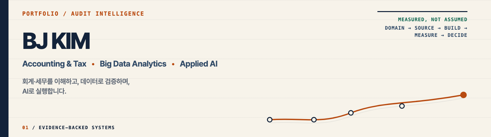

<div align="center">
  
</div>

# 안녕하세요, BJ Kim입니다

**KOSPI D사 결산 담당 · 프로젝트 기반 데이터 애널리스트**  
**회계·세무 도메인 × 빅데이터 분석 × 실전 AI 자동화**

학부에서 회계학을 전공했고, 최종학력은 빅데이터 석사입니다. 2017년 7월부터 회계·세무 실무를 수행해 온 9년차 실무자로, 휴직 등을 제외한 실경력은 8년 5개월입니다. 본업에서는 KOSPI D사의 결산·DART 공시(XBRL)·세무·내부통제를 담당하고, 외부 프로젝트에서는 데이터 애널리스트로 활동합니다. 업무 문제를 데이터로 분석하고 AI 시스템으로 구현하며, 기능의 수보다 **공식 근거, 재현 가능한 측정, 실제 실행 결과**를 중요하게 생각합니다.

## What I Do

| Accounting & Tax | Data Analytics | Applied AI |
|---|---|---|
| 회계기준·세법·공시·ERP 데이터의 구조를 해석합니다. | SQL·Python으로 대사, 이상 탐지, 재무 분석과 평가 하네스를 만듭니다. | 근거 기반 검색, 에이전트 워크플로, 로컬 자동화 시스템을 구축합니다. |

## Selected Work

### [Pareto Measurement Gates](https://github.com/kims6305-bjk/pareto-measurement-gates)

검증 레이어를 무조건 추가하지 않고, 품질과 비용을 함께 측정해 **유지·축소·제거**를 판정하는 공개 하네스입니다.

- 사전등록 → 블라인드 채점 → 통계 판정의 재현 가능한 절차
- 계기 검침 3회 판정에서 SPLIT 0/55
- 진단 비용 1,650콜 → 165콜
- 효과가 없던 메인 프로브를 실제로 폐기한 전 과정 공개

### Accounting & Tax Intelligence Systems `Sanitized`

회계기준, 세법, 판례와 실무 자료를 검색·대조해 근거와 함께 답하는 AI 시스템을 운영합니다.

- K-IFRS·법령·판례·해석례 기반 검색
- 주장과 인용 원문의 구조·주소·의미를 분리 검증
- 검색 품질을 골드셋과 리플레이로 측정
- 민감 데이터와 공개 지식소스를 분리한 로컬 우선 설계

> 내부 데이터와 운영 주소는 공개하지 않으며, 포트폴리오에는 합성 데이터와 익명화된 평가 결과만 사용합니다.

### Tax Filing Automation `Sanitized`

국세청 공식 수록형식과 신고 매뉴얼을 기준으로 전자신고 변환파일을 생성하는 로컬 데스크탑 워크플로를 구축했습니다.

- 신고 방식별 입력 마법사
- 공식 고정길이 레코드 규격 기반 출력
- CP949·파일 형식·자리수 검증
- 실행되는 더미와 실제로 유효한 결과물을 구분하는 원문 대조 게이트

### [ChatGPT Web Jjonku Writer](https://github.com/kims6305-bjk/chatgpt-web-jjonku-writer)

웹 ChatGPT 채팅 사용량을 Claude·Codex 한도의 예비로 쓰도록 만든 도구 모음입니다. 웹 채팅은 Codex 사용량과 별도로 계산되며, 이 점은 OpenAI 공식 문서로 확인했습니다.

- **Writer:** 웹 ChatGPT가 로컬 저장소를 읽고 고치고 테스트·커밋·PR까지 하는 제한형 MCP Git writer (shell 미노출, 저장소·브랜치·보호 경로 제한)
- **Handoff:** 웹 ChatGPT가 로컬 에이전트에 작업을 넘기고, 사람이 ID로 승인한 것만 실행
- **webgpt/:** 로컬 페이지에서 웹 ChatGPT에 질문·테스트 주도 코드 작성·사용자 스킬 실행
- 실패 가드 self-check와 happy-path E2E 테스트 포함
- 한계 명시: `webgpt/`는 비공식 웹 UI 자동화라 약관 위반 위험이 있음

### [Aside Combination Jev](https://github.com/kims6305-bjk/aside-combination-jev)

AI가 브라우저에서 클릭·입력하기 전에 정책으로 막고, 실행 기록을 영수증으로 남기는 로컬 하네스입니다. 정책은 기본적으로 행동을 막는 쪽(fail-closed)으로 동작합니다.

- 행동 전 의도 기록 → 실행 → 재관찰 → 완료 조건 검사
- 거부 규칙이 허용 규칙보다 우선, 민감·미분류 행동은 사람 승인 필요
- SHA-256 해시체인 영수증과 네트워크 없는 오프라인 검증기
- 요청·관찰·영수증 경계에서 비밀값 차단
- Hermes 스킬과 MCP 서버(`aside-jav-mcp`) 포함
- 로컬 Playwright 예제로 4개 사례 실측 (LIVE PASS 4/4)
- 한계 명시: 브라우저 드라이버나 안전 보장이 아님. 어댑터와 계정 책임은 운영자에게 있고, 영수증 검증은 기록의 일관성만 증명함

### [Kakao Agent Router](https://github.com/kims6305-bjk/kakao-agent-router)

카카오톡 방에서 주인이 AI 에이전트에게 일을 시키고(툴콜), 채팅 인터뷰로 봇에 새 기능을 추가하는 최소 라우터입니다. 실제 운영 중인 카톡 봇에서 라우터 층만 떼어내 일반화했습니다.

- `/기능추가` 5문항 인터뷰 → 초안 → 주인 `/승인` 후에만 설치
- 실행 방식 2가지: Hermes 스킬(`hermes -s -z`) 또는 Python 플러그인
- 명령 권한 = 주인 방 AND 주인 계정, 과거 메시지 재생·덮어쓰기 금지
- 카톡 연결 방식 6가지를 4축(양방향·단톡방·툴콜·추가 인증)으로 비교한 표 포함
- 한계 명시: 비공식 LOCO 전송층은 카카오 약관 위반 위험, 봇 전용 계정 필수

### [App Security Guardian](https://github.com/kims6305-bjk/app-security-guardian)

내가 소유한 웹앱을 로컬에서만 점검하는 방어용 보안 점검 스킬입니다. 규칙을 새로 만들지 않고 검증된 오픈소스 스캐너를 순서대로 돌려 결과를 JSON 하나로 묶습니다.

- **scan(화이트박스):** Semgrep·gitleaks·osv-scanner로 위험 코드 패턴, git 기록 속 비밀키, 취약 의존성 점검
- **blackbox:** 보안 헤더(CSP·프레이밍·nosniff), 쿠키 플래그, 경로 탈출, CORS 와일드카드 점검
- **attack:** nuclei 시그니처 능동 점검 (dos·fuzz·intrusive 제외, 외부 OAST 콜백 끔)
- 안전장치를 코드로 강제: 대상은 `127.0.0.1`만, `--authorized` 없으면 요청 0건, 비밀값은 보고서에 미기록
- 단위 테스트 + 뮤테이션 검사 (일부러 망가뜨린 검사 로직을 테스트가 모두 잡아야 통과)
- 루트 `SKILL.md`로 Claude Code·Codex·Hermes·OpenClaw 에이전트 스킬로 사용, 한/영 README·인포그래픽
- 한계 명시: 발견 항목은 사람이 확인할 후보이며 보안 인증이나 완전한 침투 테스트가 아님. 시그니처 기반이라 비즈니스 로직 결함은 못 찾음

## How I Work

```text
DOMAIN FIRST  →  SOURCE OF TRUTH  →  SMALL BUILD  →  REAL MEASUREMENT  →  KEEP OR REMOVE
```

- **Domain first:** 회계·세무 규칙과 실제 업무 흐름부터 이해합니다.
- **Measured, not assumed:** 성공 주장보다 분모·원자료·실행 결과를 남깁니다.
- **Privacy by boundary:** 내부 데이터, 공개 데이터, 합성 데모를 분리합니다.
- **Failure is evidence:** 실패하거나 기각된 실험도 재현 가능하게 기록합니다.

## Tools & Methods

`Python` `SQL` `SQLite` `Excel` `OpenDART` `XBRL` `RAG` `MCP` `LLM Evaluation` `GitHub Actions`

## Portfolio & Contact

상세 사례는 Notion 포트폴리오에서 `문제 → 접근 → 결과 → 증거 → 한계` 순서로 정리합니다.  
**Portfolio:** [Notion 포트폴리오](https://fifth-jute-005.notion.site/BJ-Kim-Portfolio-Accounting-Tax-Big-Data-Applied-AI-3d90802ba65380528be6d4dfac5b8181)<br>
**Email:** [kims6305@naver.com](mailto:kims6305@naver.com)

---

<sub>Accounting · Tax · Big Data · Applied AI — built with evidence.</sub>
